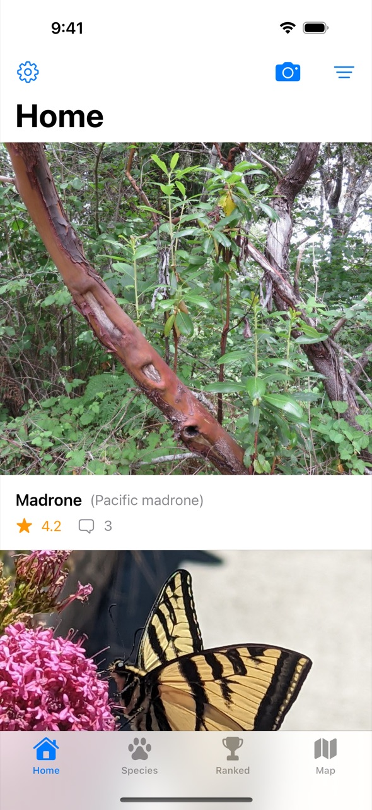
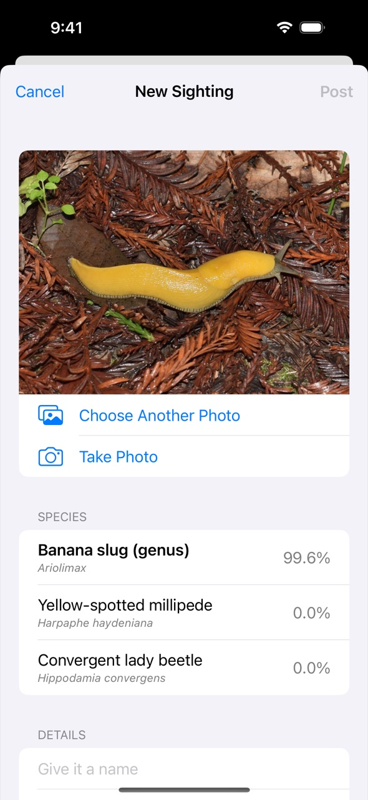
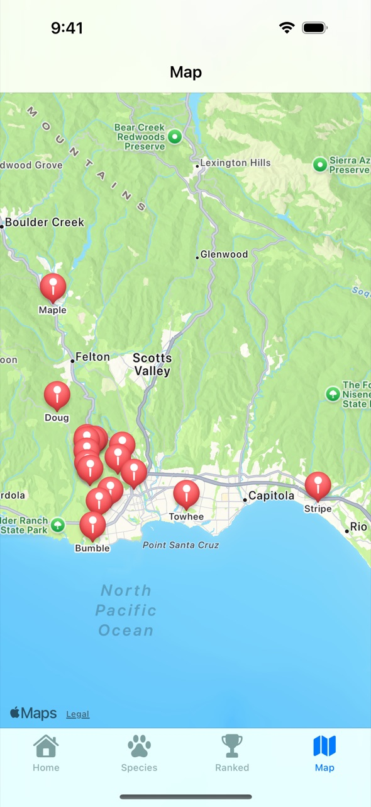

# UCSC Wildlife Vision

An iPhone app and API that identify 34 plants and animals of the UC Santa Cruz campus from a photo, and let people post, map, rate, and discuss their sightings. Identification runs on **BioCLIP 2** fine-tuned on 33,358 openly licensed iNaturalist photos. The model reaches **95.5% top-1 accuracy** and **0.951 macro-F1** on a held-out test set of 6,267 images from photographers it never saw in training.

<p align="center">
  
  &nbsp;
  
  &nbsp;
  
  &nbsp;
  
</p>

## Documentation

| Document | Contents |
|---|---|
| [Visual demo](docs/DEMO.md) | Screenshot walkthrough of the whole app, including identifying a sample photo and posting it, plus a screen recording |
| [Datasets](docs/DATASETS.md) | Where every image came from, how it was filtered and split, the 34 classes, and per-class results |
| [How it works](docs/ARCHITECTURE.md) | Training, calibration, the API and its endpoints, the inference path, and how the iOS app is organised |
| [Photo credits](docs/demo/PHOTO_CREDITS.md) | Photographer and license for every photo in the demo |

## What it recognises

| Group | Classes |
|---|---|
| Mammals (10) | Black-tailed deer, coyote, bobcat, gray fox, northern raccoon, striped skunk, California ground squirrel, eastern gray squirrel, western gray squirrel, brush rabbit |
| Birds (10) | Wild turkey, California quail, Steller's jay, California scrub-jay, common raven, acorn woodpecker, Anna's hummingbird, American robin, dark-eyed junco, spotted towhee |
| Banana slug (1) | Genus *Ariolimax* |
| Trees (7) | Coast redwood, Douglas-fir, Pacific madrone, coast live oak, tanoak, California bay, bigleaf maple |
| Insects and others (6) | Monarch butterfly, western tiger swallowtail, yellow-faced bumble bee, yellow-spotted millipede, convergent lady beetle, western yellowjacket |

It only knows these 34 classes. Anything else still gets one of the 34 labels, so the app warns when the top guess is under 50%.

## Results

| Metric (test split, 6,267 images) | Value |
|---|---:|
| Top-1 accuracy | 95.48% |
| Top-3 accuracy | 98.26% |
| Macro-F1 | 0.9512 |
| Calibration error (ECE, 15 bins) | 0.0145 |

Trees, insects, and the banana slug all score 0.95 F1 or higher. The hardest classes are night and trail-camera mammals (gray fox 0.82, bobcat 0.88, raccoon 0.88, coyote 0.89). See [Datasets](docs/DATASETS.md#classes) for every class.

## How it works

1. **Data.** Research-grade iNaturalist observations with CC0 or CC BY photos, California first, deduplicated by exact and perceptual hash, 1,000 photos per class (358 for banana slug). Splits are grouped by photographer so the test set has only unseen photographers.
2. **Training.** On a Google Colab GPU, a linear head is trained on BioCLIP 2 image embeddings, then the last two transformer blocks are fine-tuned. A temperature fitted on a separate calibration split makes the percentages trustworthy.
3. **Serving.** A FastAPI service loads the 99 MB adapter on top of the BioCLIP 2 base weights from Hugging Face and classifies uploads in about 0.08 seconds on an Apple Silicon Mac. It stores sightings, ratings, and comments in SQLite.
4. **App.** A SwiftUI iOS app with Home, Species, Ranked, and Map tabs. Maps use the Google Maps SDK when a key is configured and Apple Maps otherwise.

The full details are in [How it works](docs/ARCHITECTURE.md).

## Running it

You need a Mac with Xcode 16 or later and Python 3.10 or later. The trained weights are not stored in Git because of their size. Put the training run's files in `runs/ucsc34_bioclip_v4/` (`model_adapter.pt`, `model_checksum.json`, `classes.json`, `ucsc_bioclip.json`).

```bash
# 1. Start the API on port 8080. The first run creates .venv, installs dependencies,
#    and downloads the BioCLIP 2 base weights (about 1.7 GB) from Hugging Face.
scripts/run_api.sh

# 2. Optional: species photos and demo sightings so the app is not empty.
PYTHONPATH=src:. .venv/bin/python scripts/fetch_reference_photos.py
PYTHONPATH=src:. .venv/bin/python scripts/seed_demo_sightings.py      # --clear removes them

# 3. Open the app and press Run with an iOS 18 simulator selected.
open ios/ucscdevfestapp/ucscdevfestapp.xcodeproj
```

* **Google Maps.** Copy `ios/ucscdevfestapp/ucscdevfestapp/Secrets.example.plist` to `Secrets.plist` in the same folder and set `GOOGLE_MAPS_API_KEY` to a key with the Maps SDK for iOS enabled. `Secrets.plist` is gitignored.
* **On an iPhone.** Select your phone in Xcode and sign with your Apple ID. In the app, open Settings (gear icon) and enter `http://<your-mac-ip>:8080`, with the phone and Mac on the same Wi-Fi.
* **Interactive API docs** are at `http://localhost:8080/docs` while the server runs.
* **Tests.** `pytest` for the Python side. `scripts/capture_demo.sh` replays the full app walkthrough and regenerates the demo screenshots.

## Repository layout

| Path | Contents |
|---|---|
| `notebooks/12_UCSC_34_CLASSES_BUGS_SLUGS_TREES_GPU.ipynb` | Dataset build and training for the current 34-class model |
| `src/wildlife/models/ucsc34.py` | Loads the adapter and runs inference |
| `api/` | FastAPI service. `v3.py` and `store.py` serve the app |
| `ios/ucscdevfestapp/` | SwiftUI iOS app and UI tests |
| `scripts/` | API launcher, demo data, reference photos, demo capture, photo credits |
| `docs/` | Demo walkthrough, datasets, architecture, screenshots |
| `runs/` | Training outputs (gitignored) |
| `reports/`, `configs/`, `data/manifests/`, `data/splits/` | The earlier 20-species v2 pipeline described below |

## Credits

Training images and demo photos are from [iNaturalist](https://www.inaturalist.org) contributors under CC0 and CC BY licenses. Credits for the demo photos are in [docs/demo/PHOTO_CREDITS.md](docs/demo/PHOTO_CREDITS.md), and every training image is recorded with its photographer and source in the training manifest. The base model is [BioCLIP 2](https://huggingface.co/imageomics/bioclip-2) by the Imageomics Institute (MIT license).

---

## Earlier v2 pipeline (20 species, detector plus classifier)

The sections below document the earlier two-stage pipeline, which is still in the repository and served at `/v1/predict` and `/v2/predict`.

A reproducible two-stage computer-vision system for identifying 20 wild mammal and bird species documented on the UC Santa Cruz Campus Natural Reserve:
1. **Stage 1 — Class-Agnostic Animal Detector (`src/wildlife/detect/`):** PyTorch-Wildlife **MegaDetector V6** (`MDV6-apa-rtdetr-e`, Apache-2.0) with zero-shot **OWLv2** (`google/owlv2-base-patch16-ensemble`) fallback and `crop-v1` (15%-padded square context crops).
2. **Stage 2 — 20-Species Crop Classifier (`src/wildlife/models/backbones.py`):** **BioCLIP 2** (`hf-hub:imageomics/bioclip-2`, ViT-L/14, MIT) frozen embeddings + group-regularized linear head (`T1`, with `T0` zero-shot baseline and `T2`/`T3`/`distill` escalation to `EfficientNetV2-S`).
3. **Stage 3 — Calibrated Unknown/OOD Gate & Group Rollup (`src/wildlife/models/unknown.py`):** Post-hoc temperature scaling (`temp-v2`), energy + margin + max-probability gating, full 20-class coarse-group rollup (`"Bird (species uncertain)"`), and OWLv2 confidence cap.
4. **Stage 4 — Crop-Geometry Photo Quality (`Q`: 0–100) & Composite Rating (`R`: 0–100)** + optional **Gemini 4 Argon (`gemini-4-argon`)** explanation on request or uncertain predictions.

> **Honesty & Provenance Note:** Per `MILESTONES_v2_detector_classifier.md` §0, `runs/efficientnet_b0_v1/best.ckpt` (62 KB) and `reports/baseline_metrics.md` from v1 are synthetic smoke-test outputs on 100 synthetic images, not real model accuracy. See `reports/data_card_v2.md`, `reports/detector_v2.md`, `reports/classifier_v2_t0.md`, `reports/classifier_v2_t1.md`, `reports/calibration_v2.md`, `reports/eval_v2.md`, and `reports/gemini_budget.md` for verified v2 data counts and execution gates.

### Milestone Git Branches

- `milestone-0-skeleton` through `milestone-5-deployment`: v1 scaffolding, taxonomy, manifest/split schemas, quality rubric, and FastAPI foundation.
- `milestone-6-data-pull`: Live UCSC campus frequency audit (`place_id=94596`), resolved OOD taxon IDs (`configs/ood_taxa.yaml`), Decision D1 `cdla-permissive-1.0` detector-only license gate, fixed TSV DuckDB query (`s3_open_data_query.sql`), real iNaturalist CC0/CC-BY pull (`manifest_v2.parquet`, `split_v2.csv`, `reports/data_card_v2.md`), and `tests/test_license_v2.py`.
- `milestone-7-detector`: `Detection` & `AnimalDetector` contract, `MDV6-apa-rtdetr-e` (Apache-2.0) + `OWLv2` fallback, AGPL variant blocker, `gemini_box_to_pixels()` conversion, `notebooks/05_detector_eval_labeling.ipynb`, `reports/detector_v2.md`, and detector unit tests.
- `milestone-8-crops`: `crop-v1` (15% padding, square context expansion, 512 px storage, train jitter), WebDataset `.tar` shard writer, `crops_index.parquet`, and `reports/crop_contact_sheet_v1.png`.
- `milestone-9-classifier-v2`: `BioCLIP 2` (`T0`/`T1`/`T2`) and `EfficientNetV2-S` (`T3`/`distill`) backbones, float16 `.npy` embedding cache, WebDataset loader, `--require-torch` fail-loudly enforcement, `notebooks/06` & `07`, and `tests/test_train_backend.py` + `tests/test_embedding_cache.py`.
- `milestone-10-calibration-v2`: Config-driven gate thresholds (`configs/rating.yaml`), full 20-class coarse-group rollup, OWLv2 low-confidence cap, threshold grid search (`tune_gate_thresholds_grid`), and `reports/calibration_v2.md`.
- `milestone-11-pipeline`: `WildlifePipeline` (`src/wildlife/pipeline.py`), multi-animal `/v2/predict` endpoint + `/v1/predict` wrapper, detector/crop version parity enforcement (`VersionParityError`), and 5 pipeline test suites (`tests/test_pipeline_*.py`, `tests/test_version_parity.py`, `tests/test_api_v2.py`).
- `milestone-12-eval-release`: `reports/eval_v2.md`, `reports/gemini_budget.md`, updated `reports/model_card.md`, `README.md`, and end-to-end v2 smoke test.

### Quickstart Commands

```bash
# 1. Run full v1 + v2 unit and integration test suite (44 tests)
pytest

# 2. Refresh live UCSC campus observation-frequency audit (place_id=94596)
python3 scripts/audit_campus_frequency.py --online --place-id 94596

# 3. Pull real CC0/CC-BY iNaturalist candidates and build Manifest v2 + Splits v2
python3 scripts/pull_v2_data.py --per-species-sample 12 --download-sample-images 1

# 4. Build crop-v1 dataset, WebDataset shards, and 10x20 contact sheet
python3 scripts/build_crops_v1.py

# 5. Train classifier on Colab/Vertex GPU (--require-torch enforced by default)
PYTHONPATH=src python3 -m wildlife.train \
  --config configs/train_v2.yaml \
  --manifest data/manifests/manifest_v2.parquet \
  --splits data/splits/split_v2.csv \
  --tier t1 \
  --require-torch \
  --output runs/classifier_v2_t1

# 6. Run local end-to-end smoke test (explicitly sets WILDLIFE_TEST_MODE=1 for CPU surrogate)
WILDLIFE_TEST_MODE=1 python3 scripts/smoke_test.py
```
