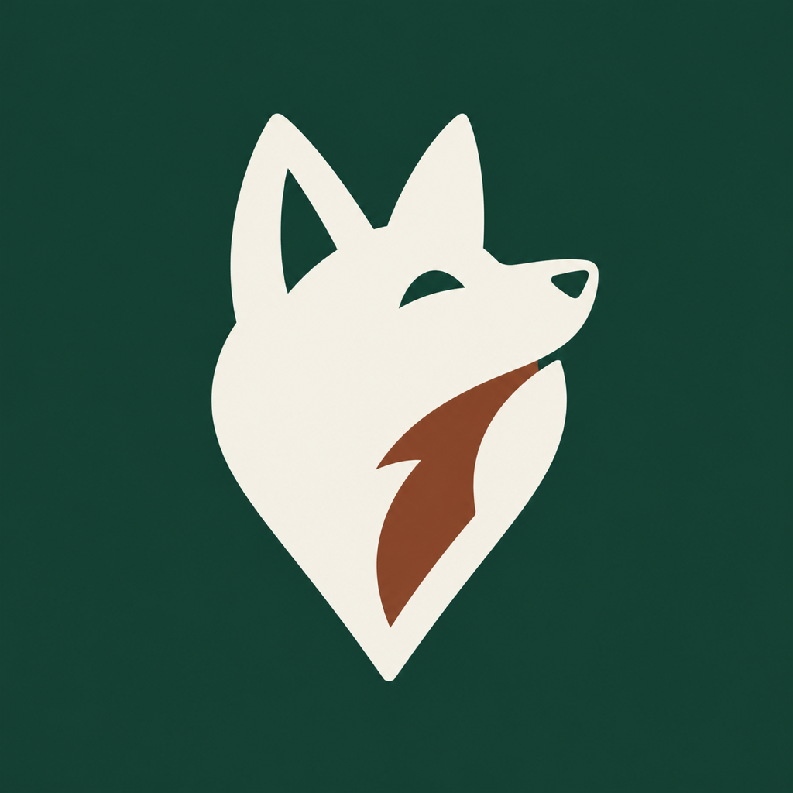

# coy



**Meet your wild neighbors.** A native iPhone app for 34 trained campus wildlife classes: identify a photo, name your sighting, mark its location, leave a comment, and explore Home, Species, Ranked, and Map.

[Watch the 90-second coy demo](coy_product_demo.mp4) · [Install on an iPhone with USB-C](docs/IPHONE_SETUP.md) · [Photo credits](coy_product_demo_credits.md)

The demo is real iOS simulator footage, edited with short feature cards and smooth transitions. It shows a live banana-slug prediction (99.6%), publishing Goldie, commenting, browsing ranked Deerly and Whiskers sightings, and locating them on the map. Seeded sightings are historical demo data with source credits; their locations are approximate. New sightings and comments are saved **on this device**; this version does not synchronize posts between users.

## Run locally

Use a Mac with Xcode compatible with your iOS version, iOS 18 or later, and Python 3.10 or later. Restore the real trained files into `runs/ucsc34_bioclip_v4/`: `model_adapter.pt`, `model_checksum.json`, `classes.json`, and `ucsc_bioclip.json`. They are intentionally excluded from Git. The working DEVFEST folder already contains them; a fresh checkout needs a copy from your completed training run.

```bash
python3 -m venv .venv
.venv/bin/python -m pip install -e '.[app,dev]'
bash scripts/run_coy.sh
```

Leave the services running. In another terminal:

```bash
curl --fail http://127.0.0.1:8081/healthz
open ios/ucscdevfestapp/ucscdevfestapp.xcodeproj
```

Choose the `ucscdevfestapp` scheme and an iOS 18+ simulator, then Run. coy defaults to `http://localhost:8081`. For a physical iPhone, follow the [USB-C, Developer Mode, signing, and Wi-Fi instructions](docs/IPHONE_SETUP.md). USB-C installs/debugs the app; inference uses your Mac's LAN address on port **8081**. The Debug build permits local HTTP. Release builds need an appropriate production transport configuration.

The launcher reuses a healthy existing model service and only stops processes it started. It never resets app data or substitutes a synthetic model. The initial prediction may download the pinned BioCLIP 2 base weights from Hugging Face.

## Features

- **Identify:** real BioCLIP-v4 confidence and alternatives for all 34 trained classes, plus image-quality heuristics.
- **Name and post:** a custom name, caption, campus area, and a point you mark on the map.
- **Home and Species:** saved sightings and a catalog with 34 bundled reference photos.
- **Ranked:** photo ratings, group filters, and links to sighting details.
- **Map:** search by name, species, or place; select a named marker/list entry and open its post.
- **Comments and likes:** saved locally and retained after reopening the app.

Maps use Apple MapKit and need no Google Maps key. The app bundles 40 original historical sightings plus 21 named entries imported from the previous app. Photo credits appear in details and the accompanying credit file. A map pin is a sighting location, not a tracked animal route.

## Model and data

| Group | Classes |
|---|---|
| Mammals (10) | Black-tailed deer, coyote, bobcat, gray fox, northern raccoon, striped skunk, California ground squirrel, eastern gray squirrel, western gray squirrel, brush rabbit |
| Birds (10) | Wild turkey, California quail, Steller's jay, California scrub-jay, common raven, acorn woodpecker, Anna's hummingbird, American robin, dark-eyed junco, spotted towhee |
| Banana slug (1) | Genus *Ariolimax* |
| Trees (7) | Coast redwood, Douglas-fir, Pacific madrone, coast live oak, tanoak, California bay, bigleaf maple |
| Insects and others (6) | Monarch butterfly, western tiger swallowtail, yellow-faced bumble bee, yellow-spotted millipede, convergent lady beetle, western yellowjacket |

The v4 adapter was trained on 33,358 openly licensed iNaturalist images. The recorded held-out test results (6,267 images from unseen photographers) are 95.48% top-1, 98.26% top-3, 0.9512 macro-F1, and 0.0145 ECE. These are dataset metrics, not guarantees for a new photo. The closed-set model always chooses among 34 labels; low confidence is flagged, but high confidence does not establish that an out-of-catalog subject belongs to the catalog. See [datasets and per-class results](docs/DATASETS.md).

coy sends the full photo to `api/coy_bridge.py` on 8081, which forwards its original bytes to the trained `/v3/identify` endpoint on 8080. The bridge adapts response fields without replacing the model's class or confidence. It does not run an animal detector. The older `/v2/predict` route on **8080** is a separate legacy pipeline and is not coy's classifier.

## Documentation and validation

| Document | Contents |
|---|---|
| [iPhone setup](docs/IPHONE_SETUP.md) | USB-C, Developer Mode, signing, local model connection, troubleshooting |
| [Architecture](docs/ARCHITECTURE.md) | Native app, genuine inference, local storage, and legacy API separation |
| [Demo](docs/DEMO.md) | Recording details, reproduction, and verification |
| [Datasets](docs/DATASETS.md) | Image sources, filtering, splits, and class metrics |
| [Credits](coy_product_demo_credits.md) | Licenses, photographers, sources, and demo-location disclosure |

```bash
.venv/bin/python -m pytest tests/test_coy_bridge.py tests/test_api_v3.py tests/test_quality.py
# Simulator build and native model/storage tests; pick an installed simulator:
xcodebuild -project ios/ucscdevfestapp/ucscdevfestapp.xcodeproj \
  -scheme ucscdevfestapp -destination 'platform=iOS Simulator,name=iPhone 16' \
  CODE_SIGNING_ALLOWED=NO -only-testing:ucscdevfestappTests test
# Optional: real UI recordings; creates a NEW simulator and adds a demo post.
bash scripts/capture_demo.sh
```

`runs/`, raw datasets, virtual environments, local server data, and signing credentials stay outside Git. Licensed resized photos bundled in the app are intentionally included. Training code and earlier pipeline reports remain below for continuity.

---

## Earlier v2 pipeline (20 species, detector plus classifier)

The sections below document the earlier two-stage pipeline, which is still in the repository and served at `/v1/predict` and `/v2/predict`.

A reproducible two-stage computer-vision system for identifying 20 wild mammal and bird species documented on the UC Santa Cruz Campus Natural Reserve:
1. **Stage 1 — Class-Agnostic Animal Detector (`src/wildlife/detect/`):** PyTorch-Wildlife **MegaDetector V6** (`MDV6-apa-rtdetr-e`, Apache-2.0) with zero-shot **OWLv2** (`google/owlv2-base-patch16-ensemble`) fallback and `crop-v1` (15%-padded square context crops).
2. **Stage 2 — 20-Species Crop Classifier (`src/wildlife/models/backbones.py`):** **BioCLIP 2** (`hf-hub:imageomics/bioclip-2`, ViT-L/14, MIT) frozen embeddings + group-regularized linear head (`T1`, with `T0` zero-shot baseline and `T2`/`T3`/`distill` escalation to `EfficientNetV2-S`).
3. **Stage 3 — Calibrated Unknown/OOD Gate & Group Rollup (`src/wildlife/models/unknown.py`):** Post-hoc temperature scaling (`temp-v2`), energy + margin + max-probability gating, full 20-class coarse-group rollup (`"Bird (species uncertain)"`), and OWLv2 confidence cap.
4. **Stage 4 — Crop-Geometry Photo Quality (`Q`: 0–100) & Composite Rating (`R`: 0–100)** + optional **Gemini 4 Argon (`gemini-4-argon`)** explanation on request or uncertain predictions.

> **Honesty & Provenance Note:** Per `MILESTONES_v2_detector_classifier.md` §0, `runs/efficientnet_b0_v1/best.ckpt` (62 KB) and `reports/baseline_metrics.md` from v1 are synthetic smoke-test outputs on 100 synthetic images, not real model accuracy. See `reports/data_card_v2.md`, `reports/detector_v2.md`, `reports/classifier_v2_t0.md`, `reports/classifier_v2_t1.md`, `reports/calibration_v2.md`, `reports/eval_v2.md`, and `reports/gemini_budget.md` for verified v2 data counts and execution gates.

### Milestone Git Branches

- `milestone-0-skeleton` through `milestone-5-deployment`: v1 scaffolding, taxonomy, manifest/split schemas, quality rubric, and FastAPI foundation.
- `milestone-6-data-pull`: Live UCSC campus frequency audit (`place_id=94596`), resolved OOD taxon IDs (`configs/ood_taxa.yaml`), Decision D1 `cdla-permissive-1.0` detector-only license gate, fixed TSV DuckDB query (`s3_open_data_query.sql`), real iNaturalist CC0/CC-BY pull (`manifest_v2.parquet`, `split_v2.csv`, `reports/data_card_v2.md`), and `tests/test_license_v2.py`.
- `milestone-7-detector`: `Detection` & `AnimalDetector` contract, `MDV6-apa-rtdetr-e` (Apache-2.0) + `OWLv2` fallback, AGPL variant blocker, `gemini_box_to_pixels()` conversion, `notebooks/05_detector_eval_labeling.ipynb`, `reports/detector_v2.md`, and detector unit tests.
- `milestone-8-crops`: `crop-v1` (15% padding, square context expansion, 512 px storage, train jitter), WebDataset `.tar` shard writer, `crops_index.parquet`, and `reports/crop_contact_sheet_v1.png`.
- `milestone-9-classifier-v2`: `BioCLIP 2` (`T0`/`T1`/`T2`) and `EfficientNetV2-S` (`T3`/`distill`) backbones, float16 `.npy` embedding cache, WebDataset loader, `--require-torch` fail-loudly enforcement, `notebooks/06` & `07`, and `tests/test_train_backend.py` + `tests/test_embedding_cache.py`.
- `milestone-10-calibration-v2`: Config-driven gate thresholds (`configs/rating.yaml`), full 20-class coarse-group rollup, OWLv2 low-confidence cap, threshold grid search (`tune_gate_thresholds_grid`), and `reports/calibration_v2.md`.
- `milestone-11-pipeline`: `WildlifePipeline` (`src/wildlife/pipeline.py`), multi-animal `/v2/predict` endpoint + `/v1/predict` wrapper, detector/crop version parity enforcement (`VersionParityError`), and 5 pipeline test suites (`tests/test_pipeline_*.py`, `tests/test_version_parity.py`, `tests/test_api_v2.py`).
- `milestone-12-eval-release`: `reports/eval_v2.md`, `reports/gemini_budget.md`, updated `reports/model_card.md`, `README.md`, and end-to-end v2 smoke test.

### Quickstart Commands

```bash
# 1. Run full v1 + v2 unit and integration test suite (44 tests)
pytest

# 2. Refresh live UCSC campus observation-frequency audit (place_id=94596)
python3 scripts/audit_campus_frequency.py --online --place-id 94596

# 3. Pull real CC0/CC-BY iNaturalist candidates and build Manifest v2 + Splits v2
python3 scripts/pull_v2_data.py --per-species-sample 12 --download-sample-images 1

# 4. Build crop-v1 dataset, WebDataset shards, and 10x20 contact sheet
python3 scripts/build_crops_v1.py

# 5. Train classifier on Colab/Vertex GPU (--require-torch enforced by default)
PYTHONPATH=src python3 -m wildlife.train \
  --config configs/train_v2.yaml \
  --manifest data/manifests/manifest_v2.parquet \
  --splits data/splits/split_v2.csv \
  --tier t1 \
  --require-torch \
  --output runs/classifier_v2_t1

# 6. Run local end-to-end smoke test (explicitly sets WILDLIFE_TEST_MODE=1 for CPU surrogate)
WILDLIFE_TEST_MODE=1 python3 scripts/smoke_test.py
```
