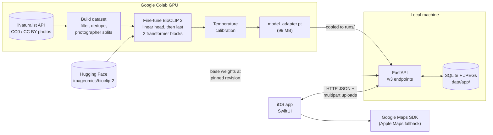

# How it works

The project has three parts. A **training notebook** builds the dataset from iNaturalist and fine-tunes BioCLIP 2 on a Colab GPU. A **FastAPI service** loads the fine-tuned model and stores sightings. A **SwiftUI iOS app** takes photos, asks the API to identify them, and shows the shared feed, species list, rankings, and maps.

## 1. Training (`notebooks/12_UCSC_34_CLASSES_BUGS_SLUGS_TREES_GPU.ipynb`)

How the images were collected and split is described in [DATASETS.md](DATASETS.md). Training starts from **BioCLIP 2** ([imageomics/bioclip-2](https://huggingface.co/imageomics/bioclip-2), MIT license). BioCLIP 2 is a CLIP-style model with a ViT-L/14 image encoder, trained by the Imageomics Institute on TreeOfLife-200M (about 214 million organism images). Its image embeddings already separate species well, so a small amount of fine-tuning is enough.

The notebook only uses the image encoder. It adds a linear layer that maps the 768-dimensional, L2-normalised image embedding to 34 class scores. Training then runs in two phases.

| | Phase 1. Head only | Phase 2. Partial fine-tune |
|---|---|---|
| Trainable weights | Linear head | Head, last 2 transformer blocks, `ln_post`, `proj` |
| Input | Cached embeddings of 2 augmented views per training photo | Photos with random resized crop (scale 0.7 to 1.0) |
| Optimiser | AdamW, lr 1e-3, weight decay 0.01 | AdamW, lr 5e-6 for the encoder and 1e-4 for the head |
| Epochs | Up to 30 | Up to 10 |
| Ran | 30 epochs, best validation macro-F1 0.9620 | Stopped after 7 epochs, best at epoch 2 with 0.9659 |

Both phases use cross-entropy with label smoothing 0.05, fp16 mixed precision, gradient clipping at 1.0, batch size 16, and early stopping after 5 epochs without a better validation macro-F1. The best checkpoint across both phases is kept.

**Calibration.** Raw neural network scores tend to be overconfident. After training, the notebook searches 201 temperatures between 0.1 and 10 and picks the one that minimises cross-entropy on the calibration split. That temperature is **0.7762**. The app's percentages are the softmax of the scores divided by this temperature.

**Output.** The notebook saves `model_adapter.pt`, which holds only what training changed: the fine-tuned encoder layers, the head, the 34 class records, the temperature, the preprocessing settings, and the pinned BioCLIP 2 revision (`2957b322`). The frozen base weights are downloaded from Hugging Face when the model is loaded. `model_checksum.json` stores the SHA-256 of the adapter, and the API refuses to load a file that does not match.

### Results on the held-out test split

| Metric | Value |
|---|---:|
| Test images | 6,267 |
| Top-1 accuracy | 95.48% |
| Top-3 accuracy | 98.26% |
| Macro-F1 | 0.9512 |
| Expected calibration error (15 bins) | 0.0145 |

Per-class F1 is listed in [DATASETS.md](DATASETS.md#classes). The weakest classes are the medium-sized mammals (gray fox 0.824, bobcat 0.878, raccoon 0.884, coyote 0.886), which are often photographed at night or on trail cameras. Every insect, tree, and the banana slug score 0.95 or higher.

## 2. API (`api/`, `src/wildlife/models/ucsc34.py`)

`scripts/run_api.sh` starts Uvicorn on port 8080. The app uses the `/v3` endpoints. The older `/v1` and `/v2` endpoints from the 20-species detector pipeline are still there and unchanged.

| Endpoint | Purpose |
|---|---|
| `GET /v3/health` | Model version, class count, whether the weights are loaded |
| `GET /v3/species` | The 34 classes with sighting counts and photo URLs |
| `GET /v3/species/{id}/image` | Reference photo for a species |
| `POST /v3/identify` | Classify an uploaded photo. Stores nothing |
| `GET /v3/sightings` | Feed, sorted by `newest`, `top_rated`, `most_comments`, or `alphabetical`, optionally filtered by species |
| `POST /v3/sightings` | Upload a photo with a name, notes, and optional coordinates. The server classifies it and saves it |
| `GET /v3/sightings/{id}` and `/image` | One sighting and its photo |
| `POST /v3/sightings/{id}/ratings` | 1 to 5 stars. One rating per device, sent in the `X-Device-Id` header |
| `GET`, `POST /v3/sightings/{id}/comments` | Comment thread |

Interactive documentation is served at `http://localhost:8080/docs` while the API runs.

### Inference path

1. The upload is checked. Only JPEG and PNG under 10 MB and 25 megapixels are accepted.
2. The image is rotated according to its EXIF orientation and converted to RGB.
3. BioCLIP 2's evaluation transform resizes the short side to 224 pixels with bicubic sampling, centre-crops to 224 x 224, and normalises the colours.
4. The image encoder produces an embedding, which is L2-normalised and passed through the linear head.
5. The scores are divided by the temperature, turned into probabilities with softmax, and the top 3 are returned.
6. `low_confidence` is set when the top probability is under 0.5.

On an Apple Silicon Mac the model runs on the GPU through PyTorch's MPS backend and takes about 0.08 seconds per photo after the first load. The model loads on the first request, or at startup with `WILDLIFE_PRELOAD=1`.

### Storage

Sightings, star ratings, and comments are kept in SQLite at `data/app/sightings.sqlite3`, and photos in `data/app/images/`. Uploaded photos are downscaled to at most 1600 pixels and re-encoded as JPEG, which drops EXIF metadata, including GPS tags. The only location stored is the one the user chose to share. The folder is gitignored.

## 3. iOS app (`ios/ucscdevfestapp/`)

The app targets iOS 18 and is built with SwiftUI. It was built from the team's Figma-based UI (Home, Species, Ranked tabs), with a Map tab, the New Sighting flow, and Settings added on top.

| File | Role |
|---|---|
| `Services/APIClient.swift` | All HTTP calls, multipart uploads, and readable error messages |
| `Services/SightingStore.swift` | Shared observable state for the feed and species list |
| `Services/LocationProvider.swift` | One-time location lookup for new sightings |
| `Views/HomeView.swift` | Feed with sorting, plus the camera and settings buttons |
| `Views/NewSightingView.swift` | Choose or take a photo, show the top 3 predictions, name it, place the pin, post |
| `Views/AnimalDetailView.swift` | Photo, map, confidence, star rating, comments |
| `Views/SpeciesView.swift` | Grid of all 34 species and the per-species list |
| `Views/RankedView.swift` | Ranked sightings |
| `Views/MapTabView.swift` | All sightings on one map, with a preview card for the tapped pin |
| `Views/SightingMapView.swift` | Single-pin map for the detail and New Sighting screens |
| `Config/AppConfig.swift` | Reads `Secrets.plist`, server address, anonymous device id |

**Maps.** The Google Maps SDK for iOS is included through Swift Package Manager (`googlemaps/ios-maps-sdk`). When `GOOGLE_MAPS_API_KEY` is set in `Secrets.plist`, every map uses Google Maps. Without a key, the same screens use Apple Maps, so the app still works out of the box. `Secrets.plist` is gitignored. Copy `Secrets.example.plist` to create it.

**Running on a phone.** A phone cannot reach the Mac as `localhost`, so the server address is set in the app's Settings screen, for example `http://192.168.1.20:8080` with both devices on the same Wi-Fi. The app's `Info.plist` allows plain HTTP only to local network addresses.

## Tests

| Command | What it covers |
|---|---|
| `pytest` | The original pipeline tests plus the `/v3` API with a stub classifier: uploads, validation, sorting, ratings, comments, species photos, demo data cleanup |
| `ucscdevfestappTests` | Placeholder unit test target |
| `ucscdevfestappUITests` | Screen smoke test, needs the API running |
| `DemoWalkthroughUITests` | The full walkthrough used for [DEMO.md](DEMO.md), run by `scripts/capture_demo.sh` |
