# Visual demo

This walkthrough shows the iOS app running in the iPhone 16 simulator against the local API and the fine-tuned 34-class model. Every screenshot was captured by a scripted UI test (`DemoWalkthroughUITests`), so the same run can be repeated with `scripts/capture_demo.sh`.

The demo has two parts. Part 1 browses the app with the demo sightings. Part 2 identifies a sample photo, posts it as a new sighting, then rates and comments on it.

<p align="center">
  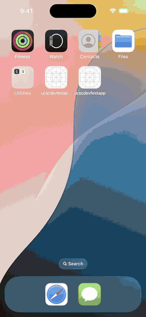
  <br>
  <sub>Part 2 as a screen recording, played at 2x speed. Full quality video: <a href="demo/identify_and_post.mp4">identify_and_post.mp4</a></sub>
</p>

## What is real and what is demo content

| Part | Source |
|---|---|
| Species predictions and confidence | The fine-tuned model running locally through `POST /v3/identify` |
| Sample photo for the identify step | A CC0 banana slug photo by Anne Parsons on iNaturalist (`docs/demo/sample_input.jpg`) |
| Species tab photos | One CC0 or CC BY iNaturalist photo per species, credited on the species screen |
| Demo sightings | Real research-grade iNaturalist observations near UCSC, with their real coordinates. The model labelled each one, and posts it got wrong or was unsure about were left out |
| Demo names, star ratings, and comments | Placeholders. Demo posts carry a DEMO label on their detail screen |
| Maps | Apple Maps. The app switches to the Google Maps SDK when a key is set in `Secrets.plist` |

Photographer credits for every photo in the screenshots are in [demo/PHOTO_CREDITS.md](demo/PHOTO_CREDITS.md).

## Part 1. Browsing the app

| | | |
|:---:|:---:|:---:|
| 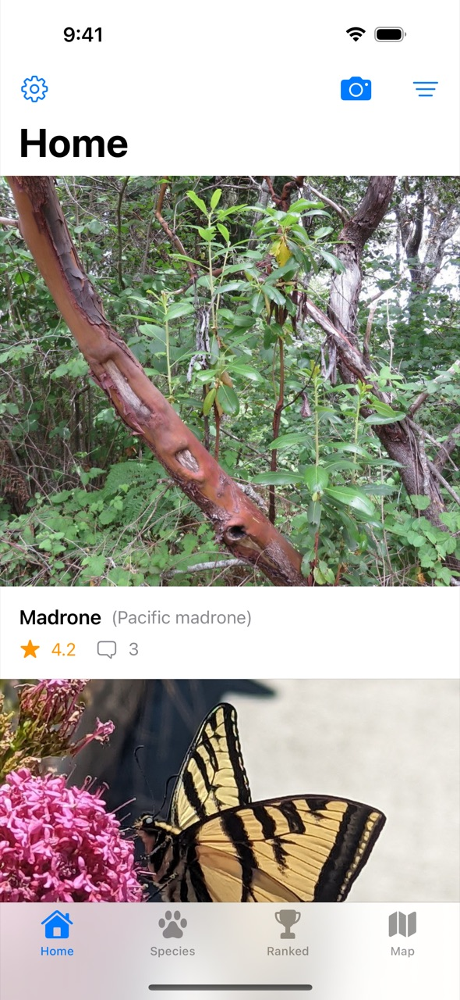 | 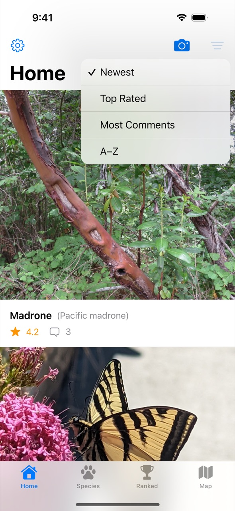 | 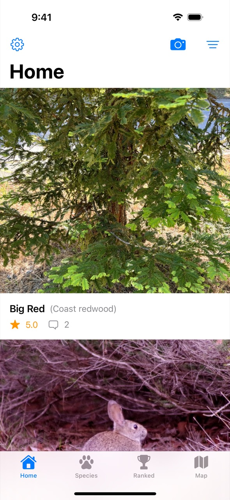 |
| **1. Home feed.** Newest sightings first, each with its photo, name, species, average star rating, and comment count. | **2. Sort menu.** Newest, Top Rated, Most Comments, or A to Z. | **3. Sorted by Top Rated.** |
| 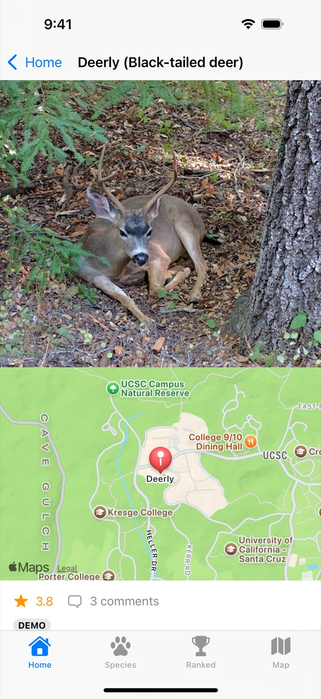 | 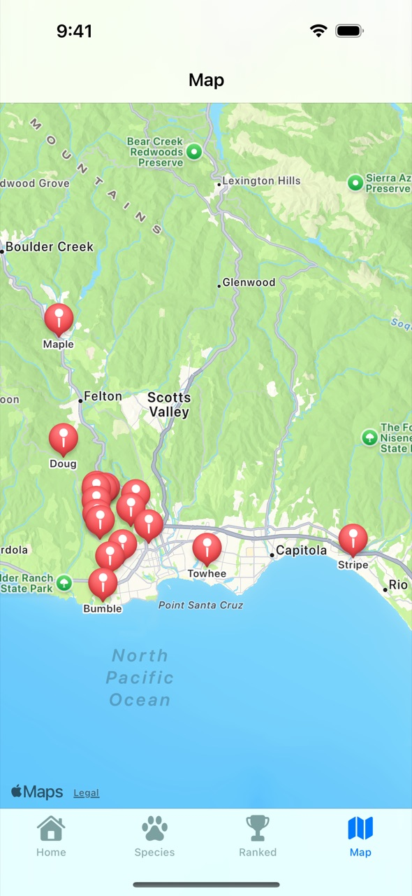 | 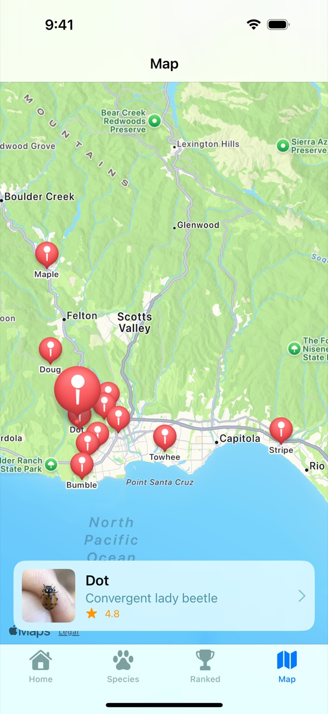 |
| **4. Sighting detail.** The photo, a map pinned where the animal was seen, and the star rating and comment count. Scrolling down shows the model confidence, your rating, and comments (see step 18). | **5. Map tab.** Every sighting with a location, around the UCSC campus. | **6. Pin preview.** Tapping a pin shows a card that opens the sighting. |
| 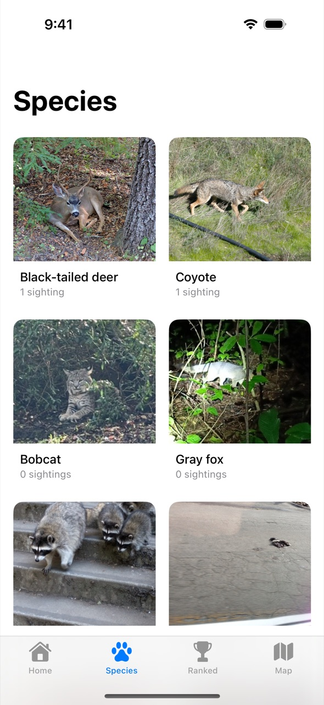 | 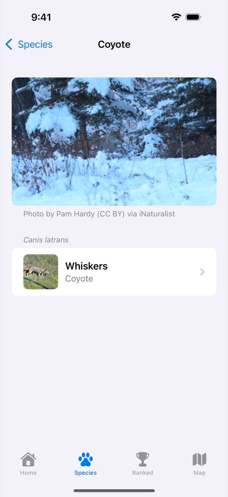 | 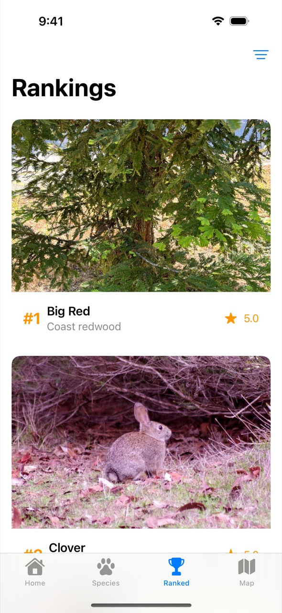 |
| **7. Species tab.** All 34 species the model knows, with how many sightings each has. | **8. One species.** A credited reference photo and every sighting of that species. | **9. Rankings.** Sightings ranked by rating, comments, or name. |

## Part 2. Identifying an animal and posting it

| | | |
|:---:|:---:|:---:|
| 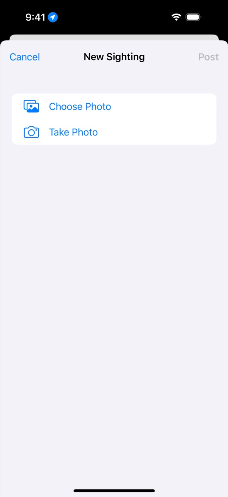 | 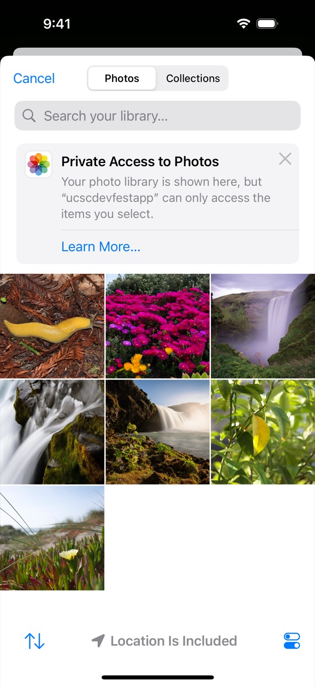 | 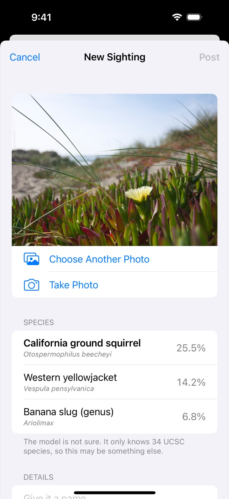 |
| **10. New sighting.** The camera button on Home opens this sheet. Choose a photo from the library or take one. | **11. Photo library.** The sample banana slug photo is the newest photo. The other photos are the simulator's built-in samples. | **12. A photo outside the 34 species.** A built-in flower photo first. The best guess is only 25.5%, so the app says the model is not sure. |
| 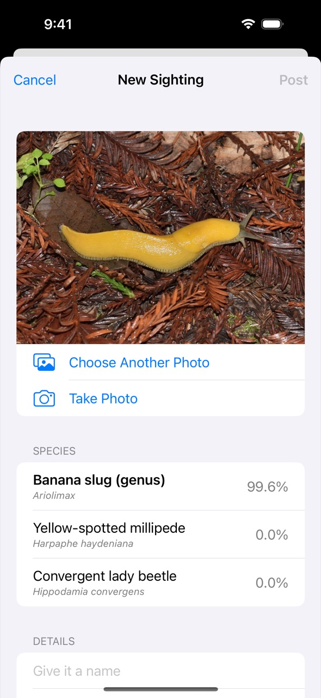 | 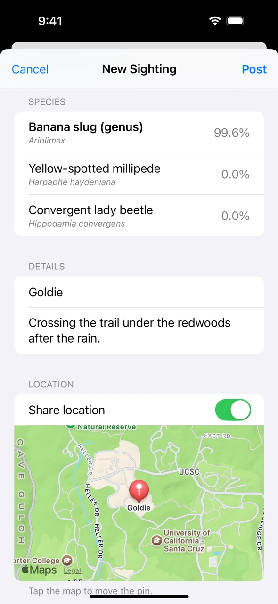 | 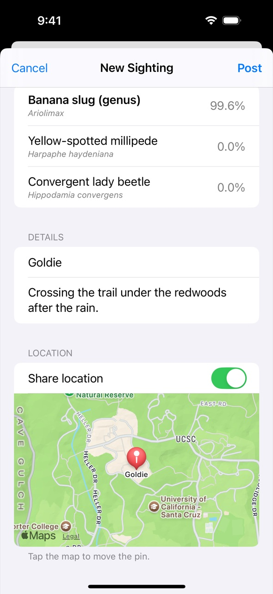 |
| **13. The sample photo.** Banana slug at 99.6%, with the next two guesses below it. | **14. Name and notes.** | **15. Location.** The pin starts at the phone's location (set to upper campus) and can be moved by tapping the map. |
| 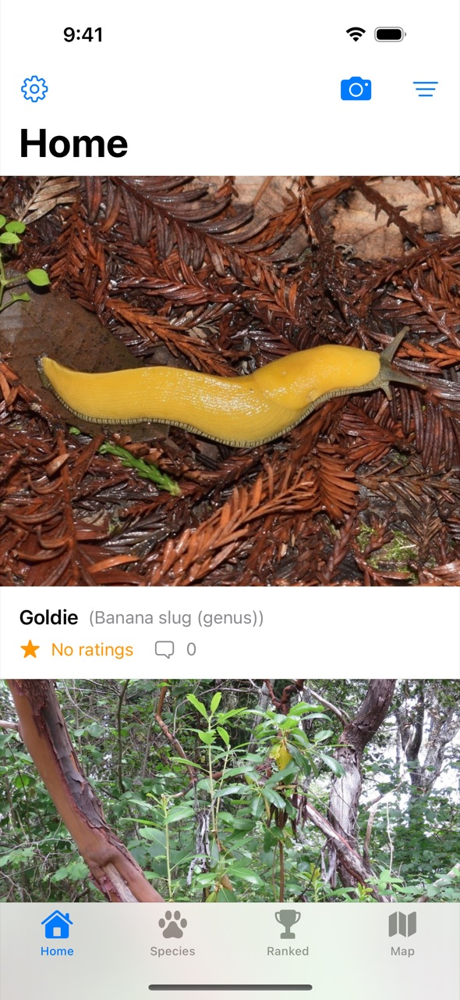 | 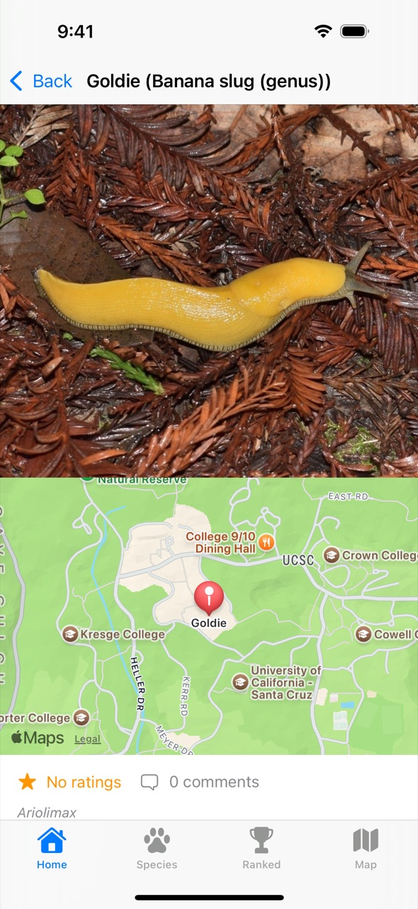 | 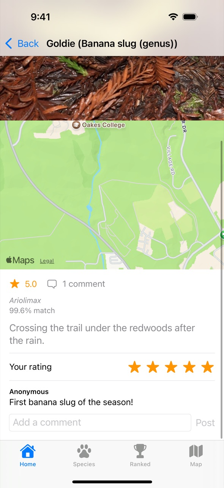 |
| **16. Posted.** The new sighting is at the top of the feed. | **17. Its detail screen.** The server ran the model again on the uploaded photo and stored the result with the post. | **18. Rated and commented.** Five stars and a comment, saved on the server. |
| 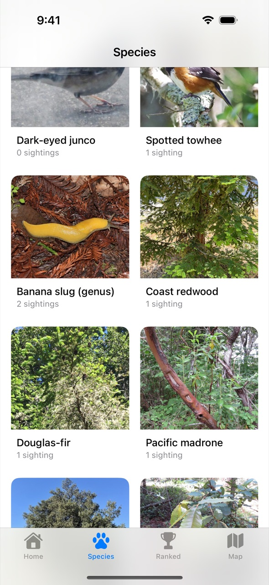 | 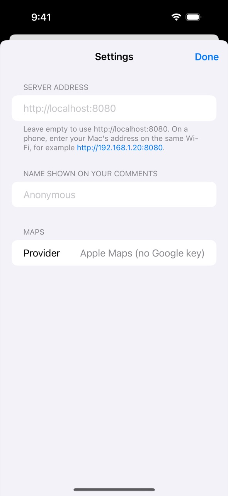 | |
| **19. Species tab after posting.** Banana slug now counts two sightings, and its card shows the newest photo. | **20. Settings.** Server address for running on a real phone, the name shown on comments, and which map provider is active. | |

## What happens when you tap Post

1. The app downscales the photo to at most 1600 pixels on the long side and uploads it as JPEG to `POST /v3/sightings` with the name, notes, and coordinates.
2. The server decodes the photo, applies its EXIF orientation, and runs the 34-class classifier on it.
3. The photo is re-encoded before it is stored, which removes EXIF metadata, including any GPS tags. The sighting, the top three predictions, and the model version are saved in SQLite.
4. The app inserts the returned sighting into the feed and refreshes the species counts.

Identification on the New Sighting screen uses `POST /v3/identify`, which runs the same model but stores nothing.

## Reproducing the demo

```bash
scripts/run_api.sh                                    # API on localhost:8080 (keep it running)
PYTHONPATH=src:. .venv/bin/python scripts/fetch_reference_photos.py
PYTHONPATH=src:. .venv/bin/python scripts/seed_demo_sightings.py
scripts/capture_demo.sh                               # screenshots, MP4, and GIF into docs/demo/
PYTHONPATH=src:. .venv/bin/python scripts/write_photo_credits.py
```

`capture_demo.sh` creates a separate simulator named "DEVFEST Demo" and erases it on every run, so your other simulators are not touched. It also fixes the status bar at 9:41, sets the simulated location to upper campus, and adds the sample photo to the library. Each run replaces the "Goldie" sighting from the previous run.
